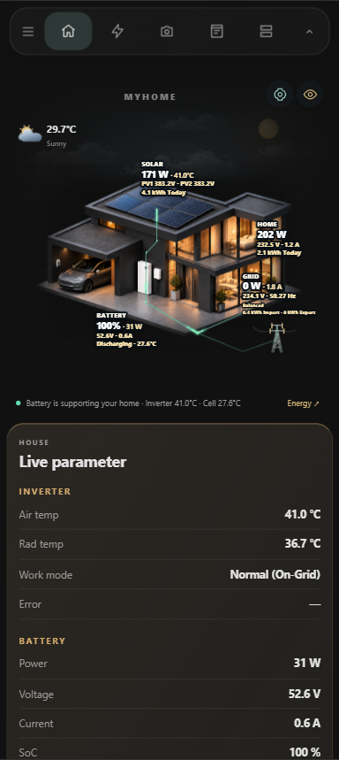
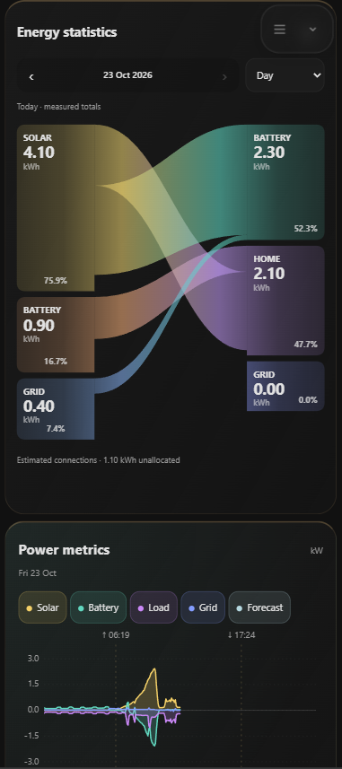

# Zee Energy Card

Mobile Home Assistant dashboard for a Goodwe solar system, house sensors, cameras, and a few appliances. The layout and animated energy scene are adapted from [narayanvs/homeassistant-dashboard](https://github.com/narayanvs/homeassistant-dashboard) (MyHome). Entity IDs are this household’s Goodwe, Zee refrigerator, water heater, AC plug, room sensors, DVR cameras, and localhost host metrics.

This is a dashboard bundle, not an installer. Copy the files into Home Assistant, register the script, and paste the dashboard.

## Screenshots

| Home | Energy |
|:---:|:---:|
|  |  |

## Views

Phone navigation (icon bar, hamburger opens the HA sidebar, hide/show button):

| View | What it shows |
|---|---|
| Home | Weather-reactive house scene, forecast, live power |
| Energy | Flow map, statistics, power chart, battery and PV strings |
| Cameras | Four DVR channels |
| Appliances | Fridge, freezer, Midea AC, water heater, AC smart plug, room temperature / humidity |
| System | Inverter status and Home Assistant host gauges |

Dashboard URL path: `dashboard-zee`.

## Install

1. Install these HACS items:
   - [mini-graph-card](https://github.com/kalkih/mini-graph-card)
   - [clock-weather-card](https://github.com/pkissling/clock-weather-card)
   - [kiosk-mode](https://github.com/NemesisRE/kiosk-mode) integration — required to hide the Home Assistant header
2. Copy `custom-cards/` to `/config/www/custom-cards/`.
3. Copy the contents of `images/` into `/config/www/` so paths like `/local/myhome-scene-v1/` resolve. The artwork filenames are unchanged from the MyHome reference.
4. Add a Lovelace resource (Settings → Dashboards → Resources):

   `/local/custom-cards/zee-energy-card.js?v=22` as a JavaScript module.

   Also add the two HACS module URLs listed in `resources/resources.json` if they are not already registered.
5. Create a dashboard with URL `dashboard-zee`, take control, and paste `dashboard/zee-energy-dashboard.yaml` into the raw configuration editor.
6. Hard-refresh the browser after the first load so the new module is picked up.

## Updating

Home Assistant serves `/local` with long cache headers, and nested JavaScript imports are cached separately from the entry module. Whenever a custom-card file changes, bump the `?v=` value on the registered resource URL in Home Assistant and on the matching import statements in `custom-cards/zee-energy-card.js`. Update `resources/resources.json` at the same time. Then hard-refresh the web UI and use the companion app's reset-frontend-cache option. Without a new version string the web UI can keep an old copy while the mobile app shows the new one.

## Editing with kiosk-mode

Kiosk-mode hides the Home Assistant header, including the three-dot menu. To edit the dashboard YAML, temporarily disable kiosk-mode by adding `?disable_km` to the dashboard URL, for example:

`/dashboard-zee/home?disable_km`

The normal header returns. Use the three-dot menu → **Edit dashboard** → three dots → **Raw configuration editor**. Remove `?disable_km` afterwards.

## Sensors

The full list is in [resources/entity-map.md](resources/entity-map.md). Battery power and grid power are sign-flipped in the energy cards (`invert_battery_power` and `invert_grid_power` from the existing Zee card config). Positive battery power is treated as charging. Positive grid power is treated as import.

There is no separate daily grid-export sensor in that config. Lifetime export uses `sensor.goodwe_meter_total_energy_export`. Self-sufficiency and self-consumption are calculated in-card from daily energy. Grid cost uses the PKR tariff and billing period saved in the Home scene settings; no external tariff or import-cost entity is required. Solar forecast and energy-learning cards from MyHome are not included.

## Credit

Scene artwork, energy flow, statistics, and power-metric cards come from the MyHome dashboard export. Third-party cards keep their own licenses.
