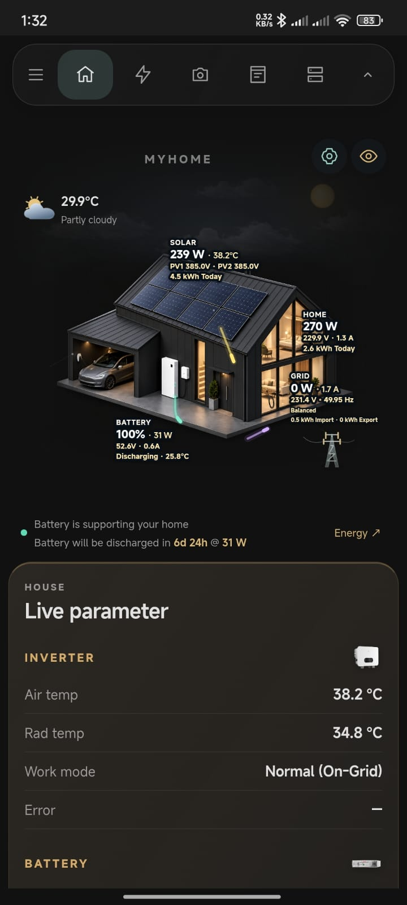
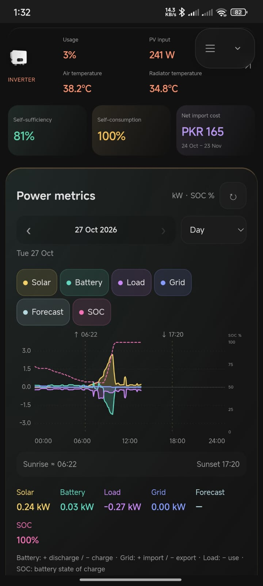
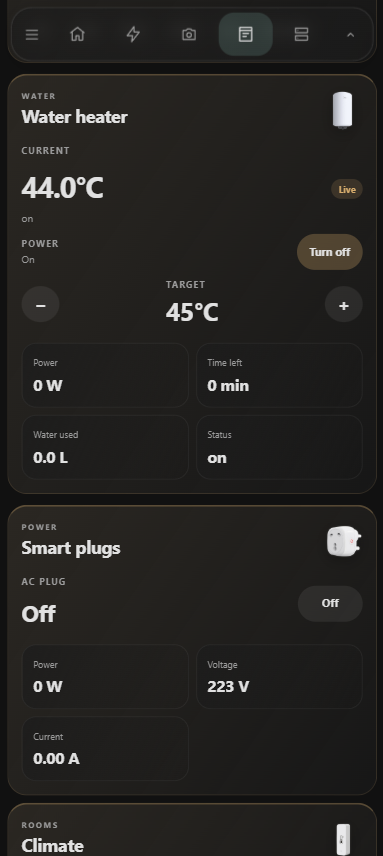
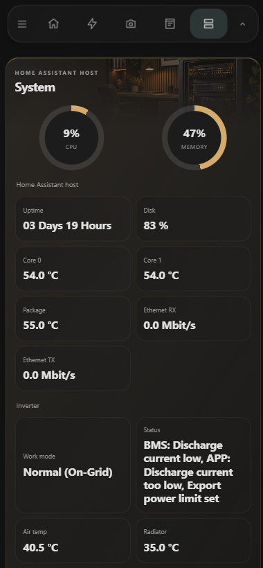

# Zee Energy Card

Mobile Home Assistant dashboard for a Goodwe solar system, house sensors, cameras, and a few appliances. The layout and animated energy scene are adapted from [narayanvs/homeassistant-dashboard](https://github.com/narayanvs/homeassistant-dashboard) (MyHome). Entity IDs are this household’s Goodwe, Zee refrigerator, water heater, AC plug, room sensors, DVR cameras, and localhost host metrics.

This is a dashboard bundle, not an installer. Copy the files into Home Assistant, register the script, and paste the dashboard.

## Screenshots

| Home | Energy |
|:---:|:---:|
|  |  |
| Appliances | System |
|  |  |

## Views

Phone navigation (icon bar, hamburger opens the HA sidebar, hide/show button):

| View | What it shows |
|---|---|
| Home | Weather-reactive house scene, live insight ribbon, forecast, live power |
| Energy | Flow map with inverter load, power metrics with SOC and period controls, energy statistics, battery and PV panels |
| Cameras | Four DVR channels with motion indicators |
| Appliances | Fridge, freezer, Midea AC, water heater, AC smart plug, room temperature / humidity |
| System | Inverter status, host gauges, storage and containers |

The Home insight ribbon shows active alerts only: grid outages, inverter errors, camera motion, open fridge/freezer doors, water heater on for over 60 minutes, and PV string underperformance. Multiple alerts rotate automatically with an `n/total` counter; tap the current alert to open the related entity. The ribbon hides when there are no alerts. Battery charge/discharge ETA is shown in the energy summary when active. The Cameras page marks active cameras with a red motion badge, and the Cameras nav tab shows a red dot while motion is active. Open a camera and use Motion history to view recent events in Home Assistant.

Dashboard URL path: `dashboard-zee`.

## Install

1. Install [kiosk-mode](https://github.com/NemesisRE/kiosk-mode) from HACS, required to hide the Home Assistant header.
2. Create `/config/www/zee-energy-card/` and copy `custom-cards/` into it, so the result is `/config/www/zee-energy-card/custom-cards/`.
3. Copy the contents of `images/` into `/config/www/zee-energy-card/images/` so paths like `/local/zee-energy-card/images/myhome-scene-v1/` resolve. The artwork filenames are unchanged from the MyHome reference. Device thumbnails live in `images/devices/` and resolve as `/local/zee-energy-card/images/devices/<file>.png`.

   Resulting layout:

   ```text
   /config/www/zee-energy-card/
     custom-cards/
     images/
       devices/
       myhome-dashboard-banners/
       myhome-scene-v1/
   ```

   All dashboard assets now live under this single folder. The previous `/config/www/custom-cards/`, `/config/www/myhome-dashboard-banners/`, and `/config/www/myhome-scene-v1/` locations are no longer used.
4. Add a Lovelace resource (Settings → Dashboards → Resources):

   `/local/zee-energy-card/custom-cards/zee-energy-card.js?v=38` as a JavaScript module.

   No additional Lovelace module resources are required; `resources/resources.json` lists only this local card.
5. Create a dashboard with URL `dashboard-zee`, take control, and paste `dashboard/zee-energy-dashboard.yaml` into the raw configuration editor.
6. Hard-refresh the browser after the first load so the new module is picked up.

## Updating

Home Assistant serves `/local` with long cache headers, and nested JavaScript imports are cached separately from the entry module. Whenever a custom-card file changes, bump the `?v=` value on the registered resource URL in Home Assistant and on the matching import statements in `custom-cards/zee-energy-card.js`. Update `resources/resources.json` at the same time. Then hard-refresh the web UI and use the companion app's reset-frontend-cache option. Without a new version string the web UI can keep an old copy while the mobile app shows the new one.

## Editing with kiosk-mode

Kiosk-mode hides the Home Assistant header, including the three-dot menu. To edit the dashboard YAML, temporarily disable kiosk-mode by adding `?disable_km` to the dashboard URL, for example:

`/dashboard-zee/home?disable_km`

The normal header returns. Use the three-dot menu → **Edit dashboard** → three dots → **Raw configuration editor**. Remove `?disable_km` afterwards.

## Sensors

The full list is in [resources/entity-map.md](resources/entity-map.md). Battery power and grid power are sign-flipped in the energy cards (`invert_battery_power` and `invert_grid_power` from the existing Zee card config). Positive battery power is treated as charging. Positive grid power is treated as import.

There is no separate daily grid-export sensor in that config. Lifetime export uses `sensor.goodwe_meter_total_energy_export`. Self-sufficiency and self-consumption are calculated in-card from daily energy. Grid cost uses the PKR tariff and billing period saved in the Home scene settings; no external tariff or import-cost entity is required. The Home battery charge/discharge ETA uses the battery capacity saved in the same settings (default 5.2 kWh). The Energy flow inverter tile shows house load against the 8 kW inverter rating; set `inverter_kw` on the energy card to override it. Solar forecast and energy-learning cards from MyHome are not included.

## Credit

Scene artwork, energy flow, statistics, and power-metric cards come from the MyHome dashboard export. Third-party cards keep their own licenses. Device images are stored in `images/devices/`.
